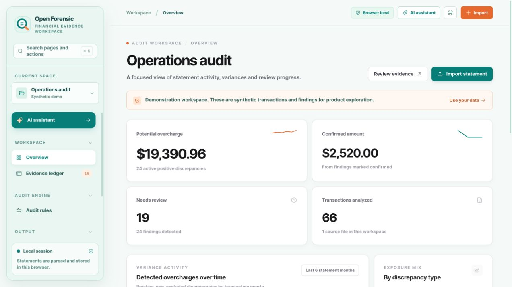
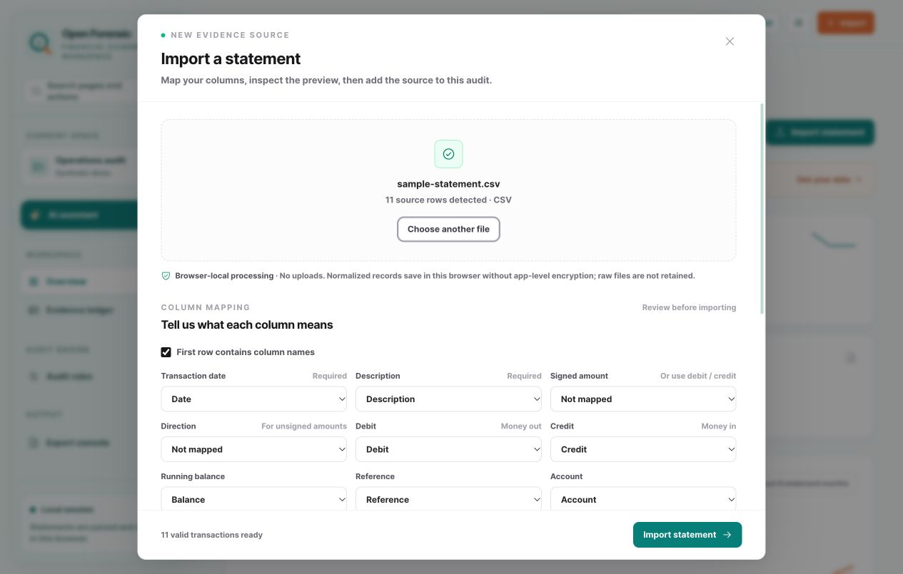
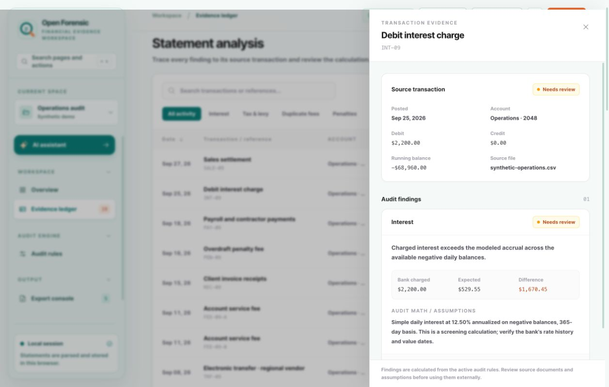
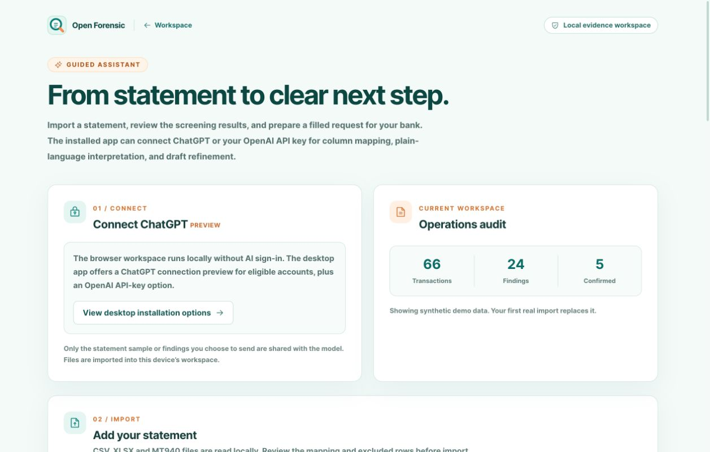

<p align="center"></p>

<h1 align="center">Open Forensic</h1>

<p align="center"><strong>Clarity in every transaction.</strong><br />A local-first workspace for turning bank statements into a review you can explain.</p>

<p align="center"><a href="https://github.com/tawandajosephmutsena/OpenForensic/releases/tag/v0.1.0">Download v0.1.0</a> · <a href="#quick-start">Quick start</a> · <a href="#assisted-review">Assisted review</a> · <a href="website/docs/index.html">Full documentation</a> · <a href="LICENSE">MIT license</a></p>



Open Forensic imports CSV, XLSX, and MT940 statements, screens transactions against rules you control, and keeps each potential finding beside its calculation and source transaction. You decide what to confirm, exclude, or reopen. The app then prepares an evidence CSV, a review PDF, and an editable request letter. Generated PDFs can be saved in the local Open Forensic workspace.

> **A screening aid, not a verdict.** A flag is a reason to inspect the source record and your account terms. Open Forensic does not determine whether a bank made an error or submit documents to a bank.

## Get the app

| Platform | Download | Installation |
| --- | --- | --- |
| Windows x64 | [Open-Forensic-Setup.exe](https://github.com/tawandajosephmutsena/OpenForensic/releases/download/v0.1.0/Open-Forensic-Setup.exe) | Run the one-click installer. This release is unsigned, so Windows may ask for confirmation. |
| macOS, Apple silicon or Intel | [Open-Forensic.dmg](https://github.com/tawandajosephmutsena/OpenForensic/releases/download/v0.1.0/Open-Forensic.dmg) | Open the universal DMG and move Open Forensic to Applications. This release is unsigned and not notarized, so macOS may warn before opening it. |
| Linux x64 | [Open-Forensic.AppImage](https://github.com/tawandajosephmutsena/OpenForensic/releases/download/v0.1.0/Open-Forensic.AppImage) | Mark the AppImage executable, then run it. |

The [release page](https://github.com/tawandajosephmutsena/OpenForensic/releases/tag/v0.1.0) includes `SHA256SUMS` for checking downloads. The browser build can be run locally with the instructions below. Its **Install app** button works in browsers that support an install prompt; other browsers show their menu instructions.

## Quick start

1. **Explore the demo.** Open Forensic starts with clearly labeled synthetic transactions. Use them to learn the dashboard and evidence ledger without importing a real statement.
2. **Import a statement.** Choose **Import**, then a CSV, XLSX, or MT940 (`.mt940` or `.sta`) file. For CSV and XLSX, map the date, description, and amount columns; choose the correct date order when ambiguous. Review the normalized preview, excluded rows, and source warnings before confirming.
3. **Confirm your assumptions.** Set the interest, tax or levy, duplicate-fee, and overdraft rules for the account you are reviewing. The starting values are examples, not current tariffs or legal rates. Apply the profile to generate findings.
4. **Inspect the evidence.** Open each finding to see its transaction and calculation. Confirm it, exclude it, or reopen it as you learn more. Decisions remain attached when you reapply the rules.
5. **Prepare your response.** Export the evidence CSV or review PDF. In **AI assistant**, fill an editable request from confirmed findings, then save its PDF to the local workspace or download it. Check every figure and statement before sharing it outside the app.



Try the import with the [sample statement](examples/sample-statement.csv). Importing your first real statement replaces the synthetic demo. Later imports can add statements to the same workspace when the currency matches and transactions do not overlap. Start a new workspace for a different currency.

## Review the evidence



The audit engine is deterministic: changing the profile changes the screening result. Each finding includes its input transaction and calculation. Your review status stays attached when you reapply rules to the same transactions.

- Export **confirmed findings** or the **full ledger** as CSV, with optional calculation notes.
- Download an A4 **review PDF** and edit or copy the bank communication draft.
- In the assistant, fill a request letter from confirmed findings, edit it, then **Save PDF to workspace**. Saved PDFs remain available after reload on the same device and can be downloaded later.
- Starting a new workspace or restoring the demo deletes its saved PDFs after confirmation. Clearing the browser profile also removes local workspace data.

## Assisted review



The assistant lays out the review in five steps: connect, import, interpret, prepare, and save documents. Its basic import and document workflow works without AI. In the **desktop app**, an optional AI connection can suggest CSV/XLSX column mappings, explain selected findings in plain language, and refine a draft request. You choose when to send each request and review the result before using it.

| Connection | Availability | Status |
| --- | --- | --- |
| ChatGPT account | Desktop app, for eligible accounts | Sign-in preview follows OpenAI's [local open-source flow](https://developers.openai.com/siwc/token-sharing-open-source/sign-in). Real-account consent and inference have not yet been verified end to end. |
| OpenAI API key | Desktop app | Optional session-only alternative, separate from a ChatGPT plan. |
| No AI connection | Browser or desktop | Manual mapping, deterministic findings, letter filling, PDF saving, and exports remain available. |

AI requests send selected sample rows or finding summaries and rule settings to OpenAI only when you click the relevant action. The browser build has no desktop account bridge. Open Forensic never submits documents to an external bank portal.

## Data stays local

Transactions, decisions, settings, and saved PDFs live in IndexedDB in this browser or desktop profile. They are **not encrypted at the application level**. Raw imported files are read locally and are not retained. This release has no statement-upload API, server database, analytics, or remote font dependency. Back up files you need before clearing browser data or resetting a workspace. Desktop ChatGPT credentials use operating-system protected storage when available and stay in memory for the session otherwise.

## Audit checks

| Check | What the app compares | What you still need to verify |
| --- | --- | --- |
| Interest | Modelled daily interest on negative running balances against an interest debit, using your annual rate, margin, method, and 360- or 365-day basis. | Value dates, historical rates, compounding, and the account agreement. |
| Tax or levy | A tax entry linked to a preceding debit with the same reference, using your rate, minimum, cap, and exemptions. | The applicable tax rules, exemptions, and whether the entries genuinely belong together. |
| Duplicate fee | Matching normalized fee descriptions and amounts within your chosen date window. | Whether the bank charged for separate services or reversed one entry later. |
| Overdraft penalty | An overdraft-related charge when the reconstructed balance immediately before it was positive. | Cleared funds, value dates, limits, and the tariff. |

These checks produce potential discrepancies for human review. They do not establish liability or current legal compliance.

## Format scope

CSV, XLSX, and standard MT940 are supported locally. Scanned PDFs, OCR, universal bank PDF layouts, encrypted-at-rest storage, and verified offline operation are not part of this build. Ask your bank for a CSV/XLSX or MT940 export when possible. Multi-account rows can coexist in one currency; separate currencies need separate workspaces so amounts are never added together without conversion.

Use monetary amounts with no more than two decimal places. The importer excludes ambiguous single-separator values such as `1,234` or `1.234` so you can correct them in the source file. It lists excluded CSV/XLSX rows and MT940 source warnings for review and acknowledgement before import. MT940 entries with unsupported finer precision are skipped with a warning. Check the preview against the source statement before importing.

## Run from source

Use Node.js 24 and pnpm 10.10.0. The repository contains the browser app, Electron desktop wrapper, and portable website source.

```bash
pnpm install
pnpm dev
```

Open `http://localhost:3000`. To inspect the production browser build, run `pnpm build` and `pnpm start`. To create the static app bundle for hosting or desktop packaging, run `pnpm export:app`. The desktop development shell can then be started with `pnpm desktop:dev`.

### Verification

```bash
pnpm test:audit
pnpm test:import
pnpm test:export
pnpm test:agent
pnpm test:desktop
pnpm typecheck
pnpm build
```

The [CI workflow](.github/workflows/ci.yml) runs these checks on pushes and pull requests. The [release workflow](.github/workflows/desktop-release.yml) builds macOS, Windows, and Linux installers from a version tag. Website source and detailed user documentation live in [`website/`](website/); publishing to a new server is a separate step.

## Project map

| Path | Purpose |
| --- | --- |
| [`src/lib/audit.ts`](src/lib/audit.ts) | Screening rules and calculations. |
| [`src/lib/parse.ts`](src/lib/parse.ts) | CSV, XLSX, and MT940 parsing and normalization. |
| [`src/lib/storage.ts`](src/lib/storage.ts) | Local workspace and saved-PDF persistence. |
| [`src/components/`](src/components/) | Dashboard, ledger, rules, import, exports, and assistant UI. |
| [`desktop/`](desktop/) | Electron shell and optional AI connections. |
| [`website/`](website/) | Portable product website and detailed documentation. |

The interface uses Next.js App Router, TypeScript, Tailwind CSS, Recharts, and Phosphor icons.

## Contributing

Issues and focused pull requests are welcome. For a rules or importer change, include a representative **synthetic** example and run the relevant verification commands. Do not include real bank statements, account numbers, credentials, or private review data in an issue or test fixture.

Open Forensic is available under the [MIT License](LICENSE).
